# Sneaker Spa 👟✨

> **Full-Stack Object-Oriented Web Application (Java 21 / Spring Boot 3 / Vanilla SPA)**  
> University OOP Project recreating the premium Sneaker Spa prototype with strict object-oriented design principles, server-authoritative business logic, and dual H2/PostgreSQL database support.

---

## 🌟 Overview

**Sneaker Spa** is a mobile-first web application for a luxury sneaker cleaning and restoration service featuring free home pickup and delivery. The application recreates the React prototype from `reference/` pixel-for-pixel using a modern vanilla JavaScript Single Page Application (SPA) styled with Tailwind CSS, backed by a robust, secure, and extensible Java 21 / Spring Boot 3 REST API.

### ✨ Key Features

- **Pixel-Accurate UI Design System**: Dark theme (`hsl(0 0% 4%)`), vibrant cyan accents (`hsl(192 100% 50%)`), glassmorphism (`glass-card`), ambient glows (`pulse-glow`), and fluid slide-in transitions.
- **7 Responsive Screen Flows + Admin Console**:
  1. **Onboarding (`#/`)**: 3-step carousel with hero sneaker imagery, value propositions, and quick authentication triggers.
  2. **Home (`#/home`)**: Personalized greeting, live loyalty points progress, "Free Pickup Today" banner, quick action cards, recent activity, photo transformation carousel, real customer reviews, and monthly subscription plan ($29/mo).
  3. **Services (`#/services`)**: Filterable service catalog (All, Popular, Budget, Premium), expandable "What's Included" feature breakdowns, and an interactive 2-service comparison drawer.
  4. **Booking Flow (`#/booking`)**: 5-step wizard with step indicator and back navigation:
     - *Step 1: Services & Add-Ons* (Multi-service checkmark selection, Express 24h, Protective Coating, Lace Swap).
     - *Step 2: Schedule* (Interactive 7-day horizontal date picker with "Today" badge, 7 time slots, special notes).
     - *Step 3: Address* (Street, city, zip, saved address selector, browser Geolocation button).
     - *Step 4: Photos* (Real multipart file upload for Front, Back, Sole, and Side angles).
     - *Step 5: Payment Summary* (Server-calculated itemized breakdown, server-validated promo code `CLEAN20` for 20% off, free pickup fee).
  5. **Orders (`#/orders`)**: Active & Past order tabs with dynamic count badges, expandable order details, status timeline, driver contact buttons, star rating submission, and 1-click reordering.
  6. **Profile (`#/profile`)**: Editable profile information, live statistics, active subscription status, saved address manager (add/edit/delete/set default), dark mode & push notification preference toggles, and secure sign-out.
  7. **Admin Console (`#/admin`)**: Protected view for administrators to monitor all customer orders, filter by status, and transition orders step-by-step through the fulfillment lifecycle.
  8. **404 Not Found (`#/404`)**: Themed fallback screen for undefined routes.

---

## 🏛️ Object-Oriented Programming (OOP) Architecture

This project was built from the ground up to showcase clean, enterprise-grade Object-Oriented design principles and recognized design patterns.

### 1. Core OOP Principles

| Principle | Implementation in Sneaker Spa | Code Location |
| :--- | :--- | :--- |
| **Abstraction** | Abstract base class `CleaningService` establishes the contract for all service types with abstract methods `calculatePrice()`, `getIncludes()`, and `getDuration()`, hiding specific tier mechanics. | [`CleaningService.java`](file:///Users/paramshankar777gmail.com/Downloads/sneakerspa/src/main/java/com/sneakerspa/model/service/CleaningService.java) |
| **Inheritance** | Concrete service classes `BasicClean`, `DeepClean`, `PremiumRestoration`, and `SuedeCare` inherit from `CleaningService`, overriding base properties and specializing behavior. | [`BasicClean.java`](file:///Users/paramshankar777gmail.com/Downloads/sneakerspa/src/main/java/com/sneakerspa/model/service/BasicClean.java) |
| **Polymorphism** | `PricingService` processes orders containing diverse service selections by iterating polymorphically over `List<CleaningService>`, delegating price computation dynamically at runtime. | [`PricingService.java`](file:///Users/paramshankar777gmail.com/Downloads/sneakerspa/src/main/java/com/sneakerspa/service/PricingService.java) |
| **Encapsulation & Value Objects** | All entity and model fields are strictly `private`. Monetary values are encapsulated within the immutable `Money` value object which enforces non-negative invariants, standardizes scale/rounding (`BigDecimal`), and handles formatting. | [`Money.java`](file:///Users/paramshankar777gmail.com/Downloads/sneakerspa/src/main/java/com/sneakerspa/model/vo/Money.java) |
| **Composition** | Complex entities are assembled via composition rather than deep inheritance trees. `OrderEntity` has-a `UserEntity`, has-a `AddressEntity`, has-many `OrderItemEntity`, has-many `OrderStatusHistoryEntity`, and has-many `OrderPhotoEntity`. | [`OrderEntity.java`](file:///Users/paramshankar777gmail.com/Downloads/sneakerspa/src/main/java/com/sneakerspa/model/entity/OrderEntity.java) |

### 2. Design Patterns

- **Factory Pattern (`ServiceFactory`)**: Decouples service instantiation from caller logic. Given a service identifier or name, creates the appropriate `CleaningService` polymorphic subclass (`BasicClean`, `DeepClean`, `PremiumRestoration`, `SuedeCare`).
- **Strategy Pattern (`PricingStrategy`)**: Encapsulates pricing algorithm variants behind a common interface:
  - `StandardPricing`: Baseline rate without discounts.
  - `PromoPricing`: Applies server-validated promotional codes (e.g., `CLEAN20` for 20% off).
  - `SubscriberPricing`: Automatically discounts registered monthly subscribers by 20%.
- **Builder Pattern (`OrderBuilder`)**: Fluent domain model builder that validates business constraints (ensuring at least one service is selected, customer is attached, and delivery address is valid) before assembling an `Order` instance.
- **Observer Pattern (`StatusChangeSubject` & `StatusObserver`)**: Notifies subscribed listeners when an order's status transitions (e.g., triggering `CustomerNotificationObserver` on transition to `OUT_FOR_DELIVERY` or `DELIVERED`).

### 3. Layered Architecture

```
com.sneakerspa
├── config       # Security configuration, CORS, password hashing, and data seeders
├── controller   # REST API endpoints (Auth, Orders, Services, User, Admin)
├── dto          # Strongly-typed request/response records with Jakarta validation
├── exception    # Custom exceptions & global @ControllerAdvice error handler
├── model
│   ├── builder  # OrderBuilder implementation
│   ├── entity   # JPA entities (OrderEntity, UserEntity, AddressEntity, etc.)
│   ├── observer # StatusChangeSubject, StatusObserver, CustomerNotificationObserver
│   ├── service  # Abstract CleaningService, subclasses, and ServiceFactory
│   ├── strategy # PricingStrategy and concrete pricing strategies
│   └── vo       # Value objects (Money)
├── repository   # Spring Data JPA repositories with query methods
└── service      # Authoritative business logic (PricingService, OrderService, etc.)
```

---

## 📊 Mermaid UML Class Diagram

```mermaid
classDiagram
    %% Interfaces
    class Payable {
        <<interface>>
        +getAmount() Money
        +getDescription() String
    }

    class Trackable {
        <<interface>>
        +getStatus() OrderStatus
        +getProgressPercentage() int
        +getTrackingCode() String
    }

    class PricingStrategy {
        <<interface>>
        +calculateFinalPrice(Money baseTotal, Money addOnsTotal) Money
        +getDiscountAmount(Money baseTotal) Money
        +getStrategyName() String
    }

    class StatusObserver {
        <<interface>>
        +onStatusChanged(OrderEntity order, OrderStatus oldStatus, OrderStatus newStatus) void
    }

    %% Value Objects
    class Money {
        -BigDecimal amount
        -Currency currency
        +of(BigDecimal) Money
        +of(double) Money
        +add(Money other) Money
        +multiply(double factor) Money
        +percentage(double pct) Money
        +formatted() String
    }

    %% Abstract Class and Hierarchy
    class CleaningService {
        <<abstract>>
        #String id
        #String name
        #String description
        #Money basePrice
        #int durationDaysMin
        #int durationDaysMax
        +calculatePrice()* Money
        +getIncludes()* List~String~
        +getDuration()* String
    }

    class BasicClean {
        +calculatePrice() Money
        +getIncludes() List~String~
        +getDuration() String
    }

    class DeepClean {
        +calculatePrice() Money
        +getIncludes() List~String~
        +getDuration() String
    }

    class PremiumRestoration {
        +calculatePrice() Money
        +getIncludes() List~String~
        +getDuration() String
    }

    class SuedeCare {
        +calculatePrice() Money
        +getIncludes() List~String~
        +getDuration() String
    }

    CleaningService <|-- BasicClean
    CleaningService <|-- DeepClean
    CleaningService <|-- PremiumRestoration
    CleaningService <|-- SuedeCare
    CleaningService ..|> Payable

    %% Strategy Implementations
    class StandardPricing {
        +calculateFinalPrice(Money base, Money addOns) Money
        +getDiscountAmount(Money base) Money
    }
    class PromoPricing {
        -String promoCode
        -double discountPercentage
        +calculateFinalPrice(Money base, Money addOns) Money
        +getDiscountAmount(Money base) Money
    }
    class SubscriberPricing {
        -double discountPercentage
        +calculateFinalPrice(Money base, Money addOns) Money
        +getDiscountAmount(Money base) Money
    }

    PricingStrategy <|.. StandardPricing
    PricingStrategy <|.. PromoPricing
    PricingStrategy <|.. SubscriberPricing

    %% Factory Pattern
    class ServiceFactory {
        +createService(String serviceType) CleaningService
    }
    ServiceFactory ..> CleaningService : creates

    %% Builder Pattern
    class OrderBuilder {
        -UserEntity customer
        -AddressEntity address
        -List~CleaningService~ services
        -List~AddOn~ addOns
        -PricingStrategy strategy
        +withCustomer(UserEntity customer) OrderBuilder
        +withAddress(AddressEntity address) OrderBuilder
        +addService(CleaningService service) OrderBuilder
        +addAddOn(AddOn addOn) OrderBuilder
        +withStrategy(PricingStrategy strategy) OrderBuilder
        +build() Order
    }

    %% Observer Pattern
    class StatusChangeSubject {
        -List~StatusObserver~ observers
        +attach(StatusObserver observer) void
        +detach(StatusObserver observer) void
        +notifyObservers(OrderEntity order, OrderStatus oldStatus, OrderStatus newStatus) void
    }

    class CustomerNotificationObserver {
        +onStatusChanged(OrderEntity order, OrderStatus oldStatus, OrderStatus newStatus) void
    }
    StatusObserver <|.. CustomerNotificationObserver
    StatusChangeSubject o-- StatusObserver

    %% Domain Entities and Composition
    class OrderEntity {
        -Long id
        -String orderNumber
        -OrderStatus currentStatus
        -BigDecimal totalAmount
        -BigDecimal discountAmount
        -LocalDate pickupDate
        -String timeSlot
        -UserEntity user
        -AddressEntity pickupAddress
        -List~OrderItemEntity~ items
        -List~OrderStatusHistoryEntity~ statusHistory
        -List~OrderPhotoEntity~ photos
    }

    class OrderItemEntity {
        -Long id
        -String serviceName
        -BigDecimal price
    }

    class OrderStatusHistoryEntity {
        -Long id
        -OrderStatus status
        -String note
        -LocalDateTime createdAt
    }

    class OrderPhotoEntity {
        -Long id
        -String photoAngle
        -String filePath
    }

    class UserEntity {
        -Long id
        -String name
        -String email
        -String password
        -Role role
        -int loyaltyPoints
        -boolean subscribed
    }

    class AddressEntity {
        -Long id
        -String street
        -String city
        -String zipCode
        -boolean isDefault
    }

    OrderEntity ..|> Trackable
    OrderEntity ..|> Payable
    OrderEntity "1" *-- "many" OrderItemEntity : contains
    OrderEntity "1" *-- "many" OrderStatusHistoryEntity : tracks
    OrderEntity "1" *-- "many" OrderPhotoEntity : contains
    OrderEntity "many" o-- "1" UserEntity : placed by
    OrderEntity "many" o-- "1" AddressEntity : delivers to
    UserEntity "1" *-- "many" AddressEntity : has saved
```



---

## 🛠️ Technology Stack

- **Backend**:
  - Java 21 (Temurin JDK)
  - Spring Boot 3.3.4 (Spring Web, Spring Data JPA, Spring Security, Validation)
  - JJWT (JSON Web Token 0.12.6) for stateless authentication
  - BCrypt password hashing
  - Maven 3.9+ build automation
- **Databases**:
  - **Dev**: H2 in-memory relational database with embedded web console
  - **Prod**: PostgreSQL (Neon Serverless Postgres)
- **Frontend**:
  - Vanilla HTML5 / JavaScript (ES6+ Single Page Application with hash router)
  - Tailwind CSS (via CDN script configured in accordance with prototype theme)
  - Google Fonts: Space Grotesk (display/headings) & Inter (body)
  - Lucide Icons (CDN)
- **DevOps & Containerization**:
  - Multi-stage Dockerfile optimized for Render web services and Neon PostgreSQL

---

## 🚀 Getting Started (Local Setup)

### Prerequisites
- **Java 21 or higher** (`java -version`)
- **Maven 3.9 or higher** (`mvn -version`)

### 1. Build and Run

```bash
# Clone the repository
cd sneakerspa

# Run unit tests to verify pricing engine
mvn test

# Run the Spring Boot application (Dev profile using H2 database)
mvn spring-boot:run
```

Alternatively, build and run the executable JAR:
```bash
mvn clean package -DskipTests
java -jar target/sneakerspa-1.0.0.jar
```

The application will start on **`http://localhost:8080/`**.

### 2. Default Seeded Accounts

The database is pre-seeded with sample services, add-ons, reviews, and test accounts on first launch:

| Role | Email | Password | Access / Features |
| :--- | :--- | :--- | :--- |
| **Customer** | `alex@email.com` | `password123` | Active order (`#SNK-2847`), 3 past orders, 240 loyalty points, saved addresses |
| **Admin** | `admin@sneakerspa.com` | `admin123` | Full access to the order management dashboard (`#/admin`) |

*Note: You can also register a brand new account at any time via the UI.*

### 3. Developer Tools (H2 Console)
- **URL**: `http://localhost:8080/h2-console`
- **JDBC URL**: `jdbc:h2:mem:sneakerspadb`
- **Username**: `sa`
- **Password**: *(leave blank)*

---

## ⚙️ Environment Variables

The application is configured using Spring profiles (`dev` and `prod`). For production environments, configure these environment variables:

| Variable | Description | Default (Local Dev) | Production Example (Neon) |
| :--- | :--- | :--- | :--- |
| `SPRING_PROFILES_ACTIVE` | Active Spring profile | `dev` | `prod` |
| `DB_URL` | PostgreSQL JDBC Connection String | `jdbc:h2:mem:sneakerspadb` | `jdbc:postgresql://ep-xyz.neon.tech/sneakerspadb?sslmode=require` |
| `DB_USERNAME` | Database username | `sa` | `sneakeradmin` |
| `DB_PASSWORD` | Database user password | `""` | `your-secret-password` |
| `PORT` | Web server port (set automatically by Render) | `8080` | `8080` |
| `APP_JWT_SECRET` | 256-bit secret key for JWT signing | `9a3b6c2d8e4f0a...` | `<random-hex-string>` |

---

## 🚢 Production Deployment (Render + Neon)

### Step 1: Provision Serverless PostgreSQL on Neon
1. Go to [Neon.tech](https://neon.tech) and create a new project named `sneakerspa`.
2. Copy the **Pooled Connection String** provided in the Neon dashboard.
3. Note the JDBC-formatted URL: `jdbc:postgresql://<host>/<dbname>?sslmode=require`, along with the username and password.

### Step 2: Deploy Container on Render
1. Create a new account or log in to [Render.com](https://render.com).
2. Click **New +** > **Web Service**.
3. Connect your GitHub repository containing this project.
4. Select **Docker** as the runtime environment (Render detects the included multi-stage [`Dockerfile`](file:///Users/paramshankar777gmail.com/Downloads/sneakerspa/Dockerfile)).
5. In the **Environment Variables** section, configure:
   - `SPRING_PROFILES_ACTIVE` = `prod`
   - `DB_URL` = `jdbc:postgresql://<host>/<database>?sslmode=require`
   - `DB_USERNAME` = `<neon-username>`
   - `DB_PASSWORD` = `<neon-password>`
6. Click **Deploy Web Service**. Render builds the image using OpenJDK 21, starts the container, and provides your live public HTTPS URL.

---

## 🧪 Unit Testing

Unit tests for the domain and pricing engine reside in [`PricingLogicTest.java`](file:///Users/paramshankar777gmail.com/Downloads/sneakerspa/src/test/java/com/sneakerspa/pricing/PricingLogicTest.java). They verify:
- Standard pricing calculation across all polymorphic service types.
- Correct additive pricing when multiple services are combined.
- Multi-add-on pricing calculations (Express +$15, Coating +$10, Laces +$5).
- Server-authoritative `CLEAN20` promotional 20% discount validation.
- Subscriber strategy automatic 20% discount deduction.
- Value object immutability and scale protection in `Money`.

Run tests:
```bash
mvn test
```

---

## 🔌 REST API Endpoints

### Authentication
- `POST /api/auth/register`: Create a new user account with hashed credentials.
- `POST /api/auth/login`: Authenticate and receive a JWT bearer token.

### Services & Add-Ons (Public)
- `GET /api/services`: Retrieve all cleaning services with pricing, turnaround time, ratings, and inclusions.
- `GET /api/addons`: Retrieve optional cleaning add-ons.

### Orders (Authenticated)
- `POST /api/orders/calculate-price`: Authoritatively computes pricing for any combination of services, add-ons, and promo codes.
- `POST /api/orders`: Submit a new order (with delivery address, schedule, and selected services).
- `POST /api/orders/{id}/photos`: Upload photo angles (Front, Back, Sole, Side) stored locally on disk.
- `GET /api/orders`: Retrieve active and past orders for the logged-in customer.
- `GET /api/orders/{id}`: Detailed order breakdown with status history and photo links.
- `POST /api/orders/{id}/rating`: Submit a 1–5 star rating for delivered orders.

### Admin Console (ADMIN Role Only)
- `GET /api/admin/orders`: List all orders across all customers.
- `POST /api/admin/orders/{id}/status`: Advance an order to the next lifecycle stage (`PLACED` -> `PICKUP_SCHEDULED` -> `PICKED_UP` -> `CLEANING` -> `QUALITY_CHECK` -> `OUT_FOR_DELIVERY` -> `DELIVERED`).

### User Profile
- `GET /api/user/profile`: Retrieve user profile, loyalty points, and subscription state.
- `PUT /api/user/profile`: Update name and email address.
- `GET /api/user/addresses`: List saved delivery addresses.
- `POST /api/user/addresses`: Add a new delivery address.
- `PUT /api/user/addresses/{id}/default`: Set an address as the default.
- `DELETE /api/user/addresses/{id}`: Remove a saved address.

---

## 📱 Visual Showcase & Prototype Parity

All views were verified against the React prototype in `reference/` and captured with headless Chrome:

| View | Screenshot Preview |
| :--- | :--- |
| **Onboarding** | [`screenshots/onboarding.png`](file:///Users/paramshankar777gmail.com/Downloads/sneakerspa/screenshots/onboarding.png) |
| **Home** | [`screenshots/home.png`](file:///Users/paramshankar777gmail.com/Downloads/sneakerspa/screenshots/home.png) |
| **Services Catalog** | [`screenshots/services.png`](file:///Users/paramshankar777gmail.com/Downloads/sneakerspa/screenshots/services.png) |
| **5-Step Booking Flow** | [`screenshots/booking.png`](file:///Users/paramshankar777gmail.com/Downloads/sneakerspa/screenshots/booking.png) |
| **Active Order Tracking** | [`screenshots/orders.png`](file:///Users/paramshankar777gmail.com/Downloads/sneakerspa/screenshots/orders.png) |
| **Past Orders & Rating** | [`screenshots/orders_past.png`](file:///Users/paramshankar777gmail.com/Downloads/sneakerspa/screenshots/orders_past.png) |
| **Customer Profile** | [`screenshots/profile.png`](file:///Users/paramshankar777gmail.com/Downloads/sneakerspa/screenshots/profile.png) |
| **Admin Operations** | [`screenshots/admin.png`](file:///Users/paramshankar777gmail.com/Downloads/sneakerspa/screenshots/admin.png) |

---

## 📄 License
Academic Project &copy; 2026 Sneaker Spa. All rights reserved.
